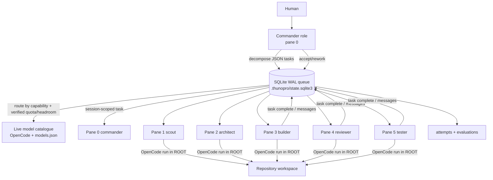

# Architecture — thunopro_agent V1

## 1. System overview

thunopro_agent V1 is a **commander-led, local, six-role tmux coordinator**. A human submits a request; the commander decomposes it into bounded tasks; each task is routed to one of six roles and one concrete model; work happens in explicitly bound tmux panes running OpenCode CLI; durable SQLite state is the source of truth.

Core components:

- `thunopro_agent/core.py`: domain model, SQLite schema, routing, task lifecycle, mailbox, tmux binding/dispatch, worker execution.
- `thunopro_agent/cli.py`: explicit human-facing commands; no background daemon.
- `.thunopro/state.sqlite3`: durable queue, messages, events, evaluations, attempts, pane bindings, metadata.
- `.thunopro/models.json`: verified quota/capability metadata and routing policy.
- tmux: six visible panes, one per role, in one explicitly bound session.

## 2. Commander-led decomposition

The commander owns the plan. Decomposition is explicit and bounded:

- `plan` previews one route for one request/kind/model; it does **not** persist tasks.
- `delegate` asks the commander model to return **1–8 JSON tasks** (prompt asks for 2–5), then persists them.
- Each task requires `title`, `description`, `kind`, and `agent`.
- `acceptance` is optional and stored per task.
- `depends_on` may only reference earlier task indexes, so dependency graphs stay acyclic and reviewable.
- The delegate prompt instructs the commander not to create a task for `commander`, but implementation allows `commander` as an assignable role.
- Tasks must state a clear deliverable and acceptance check in their description/acceptance field.
- Scope is not expanded by workers; commander reconciles results.

Commander model selection uses `choose_model("reasoning")` unless `--model` overrides it. `delegate` tries the commander model plus up to two additional top-ranked models on failure and disables region/policy-failed models.

## 3. Six roles

Roles are job functions, not model identities. Models are selected per task.

| Slot | Role | Capabilities | Responsibility |
|---:|---|---|---|
| 0 | commander | planning, delegation, review | Decompose, route, resolve dependencies, accept/reject |
| 1 | scout | research, long_context | External research and repository reconnaissance |
| 2 | architect | reasoning, architecture | Designs, interfaces, tradeoffs, risks |
| 3 | builder | coding, testing | Implement one bounded change |
| 4 | reviewer | reasoning, review, coding | Independent correctness/security review |
| 5 | tester | testing, coding | Reproducible test and acceptance evidence |

Capability gating ensures a model is eligible only if it satisfies every requirement of the inferred task kind. `TASK_REQUIREMENTS` maps kinds (`reasoning`, `coding`, `research`, `review`, `testing`, `long_context`, `fast`, `general`) to required capabilities.

## 4. Session-scoped tasks

A task is bound to exactly one tmux session:

- `bind_team(session)` requires exactly six panes and maps them to the six roles in order.
- `active_session` stores the default session in `meta`.
- `add_task` resolves the session from `--session` or `active_session`, then verifies the session and selected role exist in `panes`.
- `tasks.tmux_session` stores the bound session.
- `add_task` validates that dependencies exist and belong to the same session.
- `task_claim` verifies the role is still bound in the task's original session.
- `dispatch_task` looks up the pane by `session_name + role`, preventing cross-session dispatch.
- Dispatch also verifies the pane's current working directory equals `ROOT`, refusing cross-workspace execution.

This prevents a task created in one session from being silently executed in another.

## 5. Durable SQLite queue, attempts, and mailbox

SQLite (WAL mode, foreign keys enabled, `busy_timeout=5000`) is the durable source of truth. Schema:

- `tasks`: id, title, description, kind, status, assigned_agent, selected_model, route_score, route_reason, tmux_session, acceptance, priority, depends_on (JSON), result, created_at, updated_at.
- `messages`: id, thread_id, sender, recipient, kind, body, reply_to, status, created_at.
- `events`: append-only audit log (task_id, actor, event, details, created_at).
- `evaluations`: id, task_id, model, score, outcome, notes, created_at.
- `attempts`: id, task_id, model, status, exit_code, output, started_at, finished_at.
- `panes`: pane_id, session_name, role, model, updated_at.
- `meta`: key/value (e.g. active_session).

Task state machine: `queued -> running -> awaiting_review -> done`; rework requeues `awaiting_review -> queued`; `failed` is terminal.

- Claim requires assignment match, unfinished dependencies cleared, `queued` status, and a bound pane; uses `BEGIN IMMEDIATE` and row-count check for concurrency.
- `task_complete` requires `running` status and assignment match; sets `failed` if `--failed`, otherwise `awaiting_review`. It does not mark `done`.
- `done` is set only by `task_accept(..., "accept")`.
- Dependencies are checked at claim time.
- Messages are addressed (`sender`, `recipient`), typed (`notify`, `request`, `reply`, `delegate`), and polled by recipient; delivery is durable, not push-based. Replies preserve thread id.
- `events` provide an audit trail for planning, routing, dispatch, completion, and evaluation.

Concurrency assumption: one local host; SQLite is not for network filesystems. `connect()` sets `PRAGMA busy_timeout=5000`. Foreign keys are enabled but no foreign-key constraints are declared. Dependency existence and same-session membership are validated in `add_task`.

## 6. Model routing

Routing is capability-first and explainable.

Live catalogue:

- `available_models()` runs `opencode models` and parses IDs with regex `^([\w.-]+/[\w.-]+)\s*$`.
- If `opencode` is unavailable, it falls back to the static 12-model `MODELS` catalog.
- If `opencode` is available but returns no models, it raises rather than routing to stale models.
- Unknown IDs receive a conservative inferred capability profile.
- `.thunopro/models.json` overlays `enabled`, `verified`, `quota_tier`, `monthly_requests`, `remaining_requests`, `monthly_tokens`, `remaining_tokens`, capabilities, and ratings.
- `enabled=False` skips a model. `verified` controls whether quota tier and counters are used; unverified models get tier 0 and no counters.
- `initialize()` seeds every available model as unverified tier 0.

Routing:

1. `infer_kind(text, explicit)` infers task kind from keywords or validates an explicit kind.
2. `rank_models(kind)`:
   - filters candidates by required capabilities;
   - applies a quality floor of 3; if none pass, raises;
   - computes allowance: 1.0 for verified tier 4; otherwise `0.7 * quota_tier / 4 + 0.3 * min(request/token headroom)` when counters exist;
   - score = `100 * allowance + 10 * quality / 5 + 2 * speed / 5 + 5.0` if model ID suffix is `-free`;
   - sorts by `(-score, -quality, id)`;
   - marks quota state `verified` only if tier > 0 or request/token counters exist.
3. `choose_model(kind)` returns the first ranked model, score, and reason.
4. `--model` overrides automatic selection only if the model passes the same capability/quality gate.

Quota policy: never assume quota; default tier is unknown (0); verified generous/unlimited tiers dominate. Ratings are relative heuristics, not benchmark claims. Free models win close ties via the 5.0 bonus, but do not override capability/quality gates or verified higher allowance. `-free` names are also marked `fast` by inference.

## 7. Review / test / accept loop

Parallelize research and independent analysis; serialize shared-file edits.

1. Commander creates bounded tasks with dependencies and acceptance checks.
2. Worker claims and executes one bounded task, possibly trying up to three models.
3. On successful execution, task becomes `awaiting_review`.
4. Reviewer independently checks correctness and security.
5. Tester runs reproducible tests and records acceptance evidence.
6. Commander accepts (`done`) or requests rework (`queued`), with at most two rework cycles.
7. `record_evaluation` stores a 0–5 score, outcome, notes, and selected model for later routing tuning.

Execution success/failure is auto-classified from OpenCode exit code and output prefix, but quality acceptance remains commander-driven.

## 8. Safe tmux dispatch

`dispatch_task` is the only path that sends input to a pane, and it is explicit:

- Resolve task and its session/role pane.
- Verify pane exists via `tmux display-message`.
- Refuse if pane command is not an idle shell (`bash`, `zsh`, `fish`, `sh`).
- Refuse if pane working directory differs from `ROOT`.
- Claim the task before sending input.
- Send `python3 -m thunopro_agent worker-run TASK_ID` with `tmux send-keys -l`, then `Enter`.
- Emit a `task.dispatched` event.

Dispatch is never triggered merely by reading a plan. If `send-keys` fails after claim, the task remains `running`; V1 does not roll it back or emit `task.dispatch_failed`.

## 9. Worker execution and fallback attempts

`worker-run` is an internal CLI command that calls `run_worker_task`:

- Requires task status `running`.
- Ranks models, places `task.selected_model` first, then other eligible models, capped at `max_attempts` (default 3).
- Updates `tasks.selected_model` on each attempt.
- Records each attempt in `attempts` with status, exit code, output, and timestamps.
- Runs `opencode run --agent build --model MODEL --dir ROOT` with a 1200-second timeout.
- Writes full output to `.thunopro/logs/{task_id}-{n}.log`.
- Classifies success as exit code 0 and output not starting with `Error:` or `Upstream request failed`.
- On success, sets task status `awaiting_review` and stores output as result.
- On region/policy failure, disables that model in `models.json`.
- If all attempts fail, sets task status `failed` and emits `task.failed`.

Commander decomposition also has bounded fallback over top-ranked models.

## 10. Commander accept and rework

`task_accept` is commander-only:

- Requires `agent == "commander"`.
- Requires decision `accept` or `rework`.
- Requires task status `awaiting_review`.
- `accept`: sets `done`, emits `task.accepted`.
- `rework`: allowed at most twice, counted via `task.rework_requested` events; sets task back to `queued` with result `Rework requested: ...`, emits `task.rework_requested` with retry number.

CLI reports `done` for accept and `queued` for rework.

## 11. Observability

- `status` shows task counts by status, recent 12 events, and active session. It does not detect stale running tasks.
- `task list` filters by session.
- `events` audit planner/router/dispatch/completion/evaluation actions.
- `message inbox` supports addressed polling with optional mark-read.
- `score` explains available model routes and quota metadata (not the design scorecard).
- `quota-config` documents verified metadata entry.

## 12. V1 limits

- Manual orchestration: no unattended review/test/accept; commander decisions remain explicit.
- Worker output is auto-classified by exit code/output prefix, but quality acceptance is commander-driven.
- No automatic retry beyond bounded model fallback and commander rework; dispatch send failure is not rolled back.
- No stale-running auto-recovery or timeout-based requeue.
- SQLite is single-host and not for network filesystems; no distributed queue.
- No live dashboard; visibility is CLI + events.
- No provider-specific adapters to parse OpenCode lifecycle/output beyond exit code and output prefix.
- Model ratings and quota tiers are heuristics/configured metadata, not benchmark claims.
- `delegate` allows 1–8 tasks in CLI validation while its prompt asks for 2–5.
- Catalog and quota metadata are machine-specific and must be verified before relying on routing.
- Dispatch assumes an idle shell pane in `ROOT`; it does not manage long-running processes.
- Schema has foreign keys enabled but no foreign-key declarations; `depends_on` existence and same session are validated in `add_task`.
- `plan` previews one route; full decomposition only happens through `delegate`.

## 13. Non-goals for V1

- Unlimited concurrent agents or deep subagent trees by default.
- Shared write access to the same checkout.
- Network/shared database orchestration.
- Automatic merge or deployment.
- Treating token volume or agent count as quality.